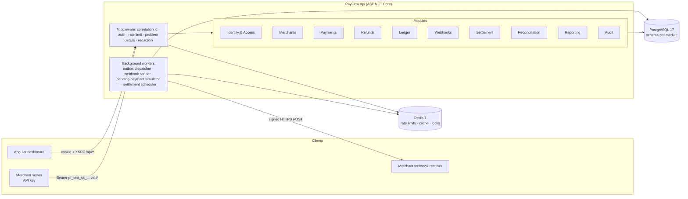

# PayFlow — Architecture

Status: **Phase 1 draft — awaiting approval.** Related: [REQUIREMENTS.md](REQUIREMENTS.md),
[DATABASE.md](DATABASE.md), [PAYMENT_LIFECYCLE.md](PAYMENT_LIFECYCLE.md), [ROADMAP.md](ROADMAP.md).

## 1. Architectural style

A **modular monolith**: one ASP.NET Core process, one PostgreSQL database, strongly separated
modules. Modules communicate through public contracts (interfaces + DTOs) and in-process
integration events delivered via a **transactional outbox**. This gives single-transaction
atomicity for financial operations (payment + ledger + outbox in one commit) without
distributed-transaction complexity, while keeping a clean seam should a module ever be extracted.



## 2. Technology choices

Versions verified against the local toolchain (.NET SDK 10.0.403, Node 22.14, Docker 29.9,
Compose v5.7). All chosen versions are current LTS / stable lines.

| Concern | Choice | Version | Why |
|---|---|---|---|
| Runtime / API | ASP.NET Core | **.NET 10 (LTS)** | LTS to Nov 2028; `TimeProvider`, `Guid.CreateVersion7`, built-in rate limiter, OpenAPI. |
| ORM | EF Core + Npgsql provider | 10.x | Migrations, `xmin` concurrency tokens, interceptors for audit/outbox. Raw SQL where precision matters (`FOR UPDATE SKIP LOCKED`, advisory locks). |
| Database | PostgreSQL | **17** | `numeric`, `timestamptz`, check constraints, partial unique indexes, row locks, advisory locks, triggers. |
| Cache / coordination | Redis | 7.4 | Distributed rate-limit counters, API-key lookup cache, short-lived job leases. **Never** the source of truth for money or idempotency. |
| Validation | FluentValidation | 12.x | Declarative request validation, testable. |
| Logging | Serilog → JSON console | 4.x | Structured logs, enrichers (correlation id), destructuring policies for redaction. |
| Telemetry | OpenTelemetry .NET | 1.x | Traces + metrics (payment latency histograms, webhook outcomes). |
| Frontend | Angular (standalone components, signals) | **21** | Current LTS line, supports Node 22.14. Final pin after `ng version` in Phase 2. |
| UI kit | Angular Material + CDK | matching | Accessible components, data tables, theming. |
| Charts | ngx-echarts (Apache ECharts) | 20.x | Mature, accessible, handles time series. |
| Unit tests (BE) | xUnit v3 + Shouldly + NSubstitute | latest | Requested stack. |
| Integration tests | `WebApplicationFactory` + **Testcontainers** (Postgres, Redis) | latest | Real Postgres so constraints, locks and isolation are actually tested (no in-memory provider). |
| Architecture tests | NetArchTest.eNhancedEdition | latest | Enforce module boundaries in CI. |
| Frontend unit tests | Vitest (Angular default runner) | — | Fast, Angular-supported. |
| E2E | Playwright | latest | Critical reviewer workflows. |
| Containers | Docker + Docker Compose | — | `api`, `web` (nginx serving SPA + reverse proxy), `postgres`, `redis`, `webhook-sink`. |
| CI | GitHub Actions | — | Build, test (with service containers), lint, image build, dependency + secret scanning. |

**Decisions not taken:** MediatR (license change; plain application services are clearer),
AutoMapper (explicit mapping is safer for financial DTOs), message broker (outbox + polling is
enough at this scale), in-memory EF provider for tests (does not enforce constraints).

## 3. Solution layout

```
PayFlow/
├─ src/
│  ├─ PayFlow.Api/                   # Host: endpoints, middleware, DI composition, workers
│  ├─ PayFlow.SharedKernel/          # Money, CurrencyCode, Result<T>, IDs, domain events, errors
│  ├─ PayFlow.Infrastructure/        # PayFlowDbContext, outbox, Redis, crypto, clock, migrations
│  └─ Modules/
│     ├─ PayFlow.Modules.Identity/
│     ├─ PayFlow.Modules.Merchants/
│     ├─ PayFlow.Modules.Payments/        # payments + status history + simulator
│     ├─ PayFlow.Modules.Refunds/         # refunds + reversals
│     ├─ PayFlow.Modules.Ledger/
│     ├─ PayFlow.Modules.Webhooks/
│     ├─ PayFlow.Modules.Settlement/
│     ├─ PayFlow.Modules.Reconciliation/
│     ├─ PayFlow.Modules.Reporting/
│     └─ PayFlow.Modules.Audit/
├─ web/payflow-dashboard/            # Angular workspace
├─ tools/webhook-sink/               # Reference webhook receiver (verifies signatures, dedupes)
├─ tests/
│  ├─ PayFlow.UnitTests/
│  ├─ PayFlow.IntegrationTests/
│  ├─ PayFlow.ArchitectureTests/
│  └─ e2e/                           # Playwright
├─ docs/
├─ docker-compose.yml
└─ .github/workflows/
```

Each module project has the same internal shape:

```
PayFlow.Modules.Payments/
├─ Contracts/        # PUBLIC: IPaymentsApi, DTOs, integration events — the only public surface
├─ Domain/           # internal: aggregates, value objects, state machine, domain errors
├─ Application/      # internal: use-case services (CreatePayment, GetPayment…), validators
├─ Infrastructure/   # internal: EF configurations, repositories, queries
├─ Endpoints/        # internal: minimal-API route groups registered by the module
└─ PaymentsModule.cs # public: AddPaymentsModule(services) / MapPaymentsEndpoints(app)
```

### Boundary rules (enforced by architecture tests)

1. A module may reference another module's **`Contracts` namespace only**.
2. `Domain` has no dependency on EF Core, ASP.NET Core or Infrastructure.
3. Endpoints never touch `DbContext` directly — they call application services.
4. Only the Ledger module writes ledger tables; other modules request postings through `ILedgerApi`.
5. Only the owning module writes its schema. Reporting reads via dedicated read models/views.

### Single DbContext, schema per module

One `PayFlowDbContext` composed from per-module `IEntityTypeConfiguration`s, each mapped to its
own PostgreSQL schema (`merchants`, `payments`, `refunds`, `ledger`, `webhooks`, `settlement`,
`reconciliation`, `audit`, `identity`, `platform`). A single context lets a payment status change,
its ledger journal entry, audit record and outbox message commit **atomically** in one
transaction. Module isolation is a code-level rule (above), not a database-level one.

## 4. Request pipeline

Order of middleware for both API surfaces:

1. Forwarded headers (behind nginx) → HTTPS redirection/HSTS → security headers
2. **Correlation id** — accept `X-Correlation-Id` (validated) or create one; push to log scope, response header, outbox messages and webhook headers
3. Exception handler → RFC 9457 **ProblemDetails** with a stable `code` and `correlationId` (no stack traces outside Development)
4. Authentication (API key handler for `/v1`, cookie for `/api`)
5. **Rate limiting** (Redis-backed, partitioned per API key / user / IP)
6. Authorization (policies + tenant scope)
7. Idempotency filter (on endpoints that declare it)
8. Endpoint → validator → application service → domain → unit of work commit

## 5. API surfaces

| Surface | Prefix | Consumer | Auth | Style |
|---|---|---|---|---|
| Merchant API | `/v1` | Merchant back-ends | `Authorization: Bearer pf_test_sk_…` | Public, versioned, idempotent writes, cursor pagination. |
| Dashboard API | `/api` | Angular SPA (same origin) | HttpOnly cookie + anti-forgery token | Internal BFF; may change with the UI. |
| Ops | `/health/live`, `/health/ready`, `/metrics` | Docker / monitoring | Network-restricted | — |

Full endpoint catalogue is written in API.md during Phase 3–7 as endpoints are built.

## 6. Background processing

All workers are `BackgroundService`s inside the API host, safe to run on multiple instances.

| Worker | Trigger | Concurrency control |
|---|---|---|
| **Outbox dispatcher** | Poll every 1 s | `SELECT … FOR UPDATE SKIP LOCKED LIMIT n`; handlers idempotent by message id (inbox table). |
| **Webhook sender** | Poll due deliveries | `SKIP LOCKED`; per-delivery `next_attempt_at`; HTTP timeout 10 s. |
| **Pending-payment simulator** | Poll payments in `Pending` past their simulated resolve time | Optimistic concurrency on payment row. |
| **Settlement scheduler** (optional daily) | Cron-like, configurable | Postgres advisory lock per (merchant, currency); unique constraints as final guarantee. |
| **Idempotency record sweeper** | Hourly | Deletes expired records only. |

## 7. Security architecture (summary — detailed in SECURITY.md)

| Control | Design |
|---|---|
| Dashboard auth | ASP.NET Core Identity with PBKDF2-HMAC-SHA512 at 210,000 iterations (OWASP 2023 figure for that hash), 12+ character passwords without composition rules (NIST SP 800-63B), refused if they appear in a bundled breach list or contain the user's email name, display name or "PayFlow", lockout after 5 failures for 15 min, identical 401 for unknown user / wrong password / locked out, constant-time dummy hash for unknown users. TOTP MFA (RFC 6238, secret encrypted at rest, each code accepted once, 10 single-use recovery codes stored as salted hashes) required for platform admins and optional for merchant users; a password alone gives such users only a 5-minute pending sign-in, and failed codes count towards the lock-out. Session via `__Host-payflow.session` (HttpOnly, Secure, SameSite=Strict), sliding 30 min, absolute 12 h, security stamp and claims revalidated every minute. No tokens in `localStorage`. |
| CSRF | Angular's built-in XSRF support with ASP.NET Core antiforgery (`X-XSRF-TOKEN`). |
| Merchant API keys | Format `pf_test_sk_<8-char prefix>_<32-byte base62 secret>`. Stored as prefix + **HMAC-SHA256(secret, server pepper)**; constant-time compare. Shown once. Rotation with grace period. Prefix-only in logs/UI. |
| Webhook signing secrets | Needed in plaintext to sign, so stored **encrypted** (AES-256-GCM via ASP.NET Data Protection, keys persisted in DB and protected by a master key from environment/secret store). Shown once. |
| Authorization | Policies: `PlatformAdmin`, `MerchantAdmin`, `MerchantMember`; every merchant-scoped query filtered by `merchant_id` (EF global query filter from the current tenant context) + explicit ownership checks. Cross-tenant tests in CI. |
| Input validation | FluentValidation on every request; strict JSON (unknown properties rejected on `/v1`); size limits; **PAN detector** rejects any Luhn-valid 13–19 digit sequence in any string field. |
| Rate limiting | Per API key 600 requests/min, shared across instances in Redis; sign-in 10/min per client IP plus per-account lock-out. 429 with `Retry-After`. |
| Replay / duplicates | Idempotency keys on writes; webhook signatures include timestamp (5-min tolerance) and event id. |
| Redaction | Serilog destructuring policy + `[Sensitive]` attribute; `Authorization`, cookies, API keys, secrets, signatures never logged; webhook attempt logs store redacted headers. |
| Audit | Every privileged action writes an append-only audit record (actor, action, target, before/after diff, correlation id, IP, UTC time). |
| Secrets config | No secrets in `appsettings.json`. Dev: `dotnet user-secrets` / `.env` (git-ignored). Compose passes them as environment variables (local use only; production injects them from a secret store: SECURITY.md, SEC-7). Startup fails fast if required secrets are missing. |
| SSRF (webhooks) | HTTPS only (HTTP allowed for `webhook-sink` in Development), DNS resolved and private/link-local/loopback/metadata ranges blocked at connect time, no redirects followed. |
| Transport & headers | HSTS, CSP (`default-src 'self'`), `X-Content-Type-Options`, `Referrer-Policy`, `frame-ancestors 'none'`. |
| DB privileges | App role cannot `UPDATE`/`DELETE` ledger, status history and audit tables (grants + triggers). Migrations run under a separate role. |

## 8. Observability

- **Logs:** Serilog JSON on stdout, written through a bounded background queue (a synchronous console sink stalled requests under load). Every line carries the correlation id and, inside a span, the trace and span ids.
- **Traces (OpenTelemetry):** one trace per HTTP request (health probes excluded) and one per unit of background work (`outbox.dispatch`, `webhook.deliver`, `refund.process`, `payment.resolve_pending`, `payment.recover_processing`), each with its database and outbound HTTP calls as child spans and tagged `payflow.correlation_id`, so a request and the work it causes can be found together. Idle worker polls create no spans. Webhook requests never carry trace headers to merchants.
- **Metrics:** PayFlow's meter (`payflow.payments.outcomes{payflow.payment.status}`, `payflow.refunds.outcomes`, `payflow.webhooks.attempts{payflow.outcome}`, `payflow.webhooks.attempt.duration`, `payflow.worker.batch.duration{payflow.job}`, `payflow.worker.items`, `payflow.worker.failures`) plus ASP.NET Core, HttpClient, Npgsql and .NET runtime metrics. Tags never carry amounts, merchant ids or other high-cardinality or sensitive values.
- **Export:** OTLP, switched on by `OTEL_EXPORTER_OTLP_ENDPOINT` (Compose: `PAYFLOW_OTLP_ENDPOINT`); `Telemetry:TraceSampleRatio` sets the share of traces kept (0.1 under load: full sampling added ~0.5 s to p95 at 100 req/s). Compose profile `observability` runs a local viewer (traces, metrics) on http://localhost:18888.
- **Health checks:** `/health/live` (process) and `/health/ready` (Postgres, Redis).

## 9. Deployment topology (Docker Compose)

| Service | Image | Notes |
|---|---|---|
| `web` | nginx:stable-alpine | Serves Angular build; proxies `/api`, `/v1`, `/health` to `api` → same-origin cookies. |
| `api` | built from `src/PayFlow.Api/Dockerfile` (chiseled .NET 10 runtime, non-root) | Applies migrations on startup only in Development; separate `migrate` job otherwise. |
| `postgres` | postgres:17-alpine | Named volume; init script creates app and migration roles. |
| `redis` | redis:7.4-alpine | No persistence needed; password protected. |
| `webhook-sink` | built from `tools/webhook-sink` | Demo receiver with UI listing received/verified events; can be told to fail N times to demo retries. |

## 10. Implementation notes (Phase 2)

- **Versions in use:** .NET SDK 10.0.403 (runtime 10.0.14), EF Core / ASP.NET Core packages 10.0.15, Npgsql EF 10.0.3, Serilog.AspNetCore 10.0.0, FluentValidation 12.2, xUnit v3 4.0, Testcontainers 4.16, Angular CLI 21.2.13; dashboard: Angular 21.2, Angular Material 21.2, ngx-echarts 21 with ECharts 6.1, Vitest 4 with jsdom, axe-core 4.14. .NET 11 is released but is a short-term-support release; PayFlow stays on .NET 10 LTS.
- **Tests run on Microsoft.Testing.Platform** (`global.json` `test.runner`), as required by xUnit v3 on the .NET 10 SDK.
- **Startup seeding takes a Postgres advisory lock**, so several API instances starting at once cannot race to create the first PlatformAdmin. The integration tests found this race.
- **Strict JSON:** unknown request properties are rejected (400) everywhere.
- **Deferred from Phase 2:** the outbox *dispatcher* (Phase 4, when the first events exist; the table and `IOutbox` are in place); Redis-backed distributed rate limiting (Phase 3, with API keys; Phase 2 limits logins in memory per instance); OpenTelemetry (Phase 9); encryption of the Data Protection key ring with an external master key (Phase 6).

### Phase 3 notes

- **HTTPS gateway in Compose: Caddy, not nginx.** The dashboard's cookies are `Secure`-only, so the API refuses `/api` over plain HTTP (`400 https_required`). Caddy issues a local certificate with no setup (`tls internal`) and forwards `X-Forwarded-Proto`. The API trusts that header only from the Compose network (`172.31.250.0/24`). Phase 8 serves the Angular build from the same gateway, keeping dashboard and API on one origin.
- **Module dependency direction:** Merchants → Identity.Contracts (memberships, policies) and Audit.Contracts (log and query). Identity never references Merchants; the membership → merchant foreign key is added by a migration as SQL, `DEFERRABLE INITIALLY DEFERRED`.
- **The `/v1` group belongs to the host:** `MapMerchantApiGroup()` applies API-key authentication and the Redis quota once; modules map their merchant endpoints onto it.
- **API key lookups** are cached in Redis for 60 s per prefix. Revocation, rotation and merchant status changes delete the cached entries, so revocation is immediate. If Redis is down, it falls back to PostgreSQL.
- **The rate limiter fails open:** if Redis is unavailable, requests are allowed and a warning is logged. Limits protect capacity, not money; financial safety lives in PostgreSQL.
- **Invitations** use ASP.NET Identity's single-use reset tokens (3-day lifetime), returned once to the inviting admin. There is no e-mail delivery.

### Phase 4 notes

- **Two transactions per payment.** Transaction 1 commits the payment in `Processing` and links it to the idempotency key. Transaction 2 applies the simulated outcome, posts ledger entries, writes the outbox event and stores the idempotent response. A crash between them is completed by `ProcessingRecoveryJob` (after 60 s), using the same deterministic simulator.
- **Background jobs** (`IRecurringJob`, run by `RecurringWorker<T>`): pending-payment resolver (every 2 s), processing recovery (every 15 s) and idempotency sweep (hourly). Each runs in its own scope with a fresh correlation id and is safe on several instances (optimistic concurrency plus ledger uniqueness). Tests switch the timers off (`Workers:Enabled=false`) and run jobs explicitly against a fake clock.
- **Outbox events were written but not yet dispatched** in Phases 4–5. The Phase 6 dispatcher processed the backlog on first start, so no event was lost.
- **Connection sizing.** Each API instance's Npgsql pool can open up to 100 connections, so PostgreSQL's `max_connections` must exceed instances × pool size. The test container raises it to 400 because several API hosts run in parallel. That was the cause of an intermittent test failure.
- **Npgsql GSS encryption is disabled** in Compose connection strings (`GSS Encryption Mode=Disable`). The chiseled runtime image has no Kerberos library, and Npgsql otherwise logs an error on every connection.
- **Login no longer uses `UserManager.UpdateAsync` for `last_login_at`.** Its concurrency stamp made simultaneous logins of the same user fail silently and drop audit records. A regression test covers it.

### Phase 5 notes

- **Refunds is its own module, but Payments stays the only writer of payment rows.** `IPaymentRefundOperations` (Payments.Contracts) locks the row (`SELECT … FOR UPDATE`, which needs an open transaction), then reserves, completes or reverses through the `Payment` aggregate. Refund creation, refund completion and reversal all take the same lock, so they serialise per payment; Phase 7 settlement will take it too.
- **One transaction per refund request**, after the idempotency claim: lock, check balance, reserve, insert refund, store the idempotent response, commit. Any failure rolls everything back and releases the key.
- **`ISettlementLookup`** is a placeholder (nothing settled) until the Settlement module replaces it in Phase 7.
- **Deletion guard:** `AppendOnlySql.PreventDeletion` adds `BEFORE DELETE` and `TRUNCATE` triggers and revokes `DELETE` from the app role, for tables whose rows change status but must never disappear.

### Phase 6 notes

- **Outbox dispatcher (now live).** Each message is claimed alone with `FOR UPDATE SKIP LOCKED`. Every handler first inserts `(message_id, handler)` into `platform.inbox_processed`, and the handler's writes, the inbox row and `processed_at` commit together. Two dispatchers never handle a message twice. A failing message is retried on later ticks and set aside after 10 attempts. The Phase 4–5 backlog was processed on first start.
- **Webhook sender.** Due deliveries are claimed with a 60-second lease (a short `UPDATE … SKIP LOCKED`), sent outside any transaction, and the attempt plus new state are recorded in one transaction. No database transaction stays open during an HTTP call.
- **SSRF guard** (`SsrfGuard`): URLs are validated when saved (https only, no credentials, no internal names or private IP literals), and the webhook `HttpClient` uses a `SocketsHttpHandler` whose `ConnectCallback` resolves DNS itself and connects only to public addresses. That defeats DNS rebinding. No redirects, cookies or proxies. Compose turns this off (`Webhooks:AllowHttp`, `Webhooks:AllowPrivateNetworks`) only so the API can reach the local sink.
- **Master key** (`Security:MasterKey`, AES-256-GCM, `SecretProtector`) encrypts webhook signing secrets and every Data Protection key (custom `IXmlEncryptor`). This completes the item deferred from Phase 2. At startup, keys stored in plaintext by earlier versions are revoked and replaced by an encrypted key (sessions end once). Verified on the Compose database.
- **Payment completion race fixed.** `PaymentProcessor` now row-locks and re-reads the payment before completing or resolving it. Previously the recovery job and a slow original request could both complete the same payment; the ledger's unique index stopped the double posting, but the loser crashed. The webhook tests exposed this, and a regression test reproduces it (it fails without the fix).

### Phase 7 notes

- **Settlement and Reconciliation are modules of their own** and read Payments and Refunds only through contracts: `IPaymentSettlementFeed` / `IRefundSettlementFeed` (list targets, lock unsettled rows `FOR UPDATE`, mark settled) and `IPaymentLookup` / `IRefundLookup` (read-only records for matching). Payments and Refunds remain the only writers of their rows; `settlement_batch_id` is set through their aggregates.
- **`ISettlementLookup` is now real.** `AddSettlementModule` replaces the Phase 5 placeholder, so reversals check `settlement.items`. The payment aggregate also refuses to reverse once its own `settlement_batch_id` is set.
- **One transaction per merchant and currency.** A run discovers targets, then composes each in its own DI scope behind a transaction-scoped advisory lock. The unique `(item_type, source_id)` index and the one-unpaid-batch index are the final guards, so a run is safe even across instances.
- **The matching engine is pure** (`ReconciliationEngine`): lists in, verdicts out. Persistence, fingerprints and the exception upsert live in `ReconciliationService`, under a per-statement advisory lock.
- **Cross-module foreign keys** (payments/refunds → settlement batches, batches → merchants, items → payments) are added in the migration's SQL, as in earlier phases, because module models cannot reference each other's types.

### Phase 8 notes

- **Reporting reads other modules' tables, read-only.** It is the one exception to "modules talk through contracts" (ADR 021): reports aggregate across payments, refunds, settlement, reconciliation and webhooks, and going through contracts would mean loading rows to count them. It owns no tables, writes nothing, and caches results in Redis for 60 s (failing open, like the API key cache).
- **Dashboard delivery.** An unprivileged nginx container serves the Angular build; Caddy routes `/api`, `/v1` and `/health` to the API and everything else to nginx, so the dashboard and its API share one origin and the session cookie stays same-site. nginx sends a CSP with `script-src 'self'` and no inline scripts (critical-CSS inlining is turned off for that reason), plus `nosniff`, `Referrer-Policy: same-origin` and `frame-ancestors 'none'`. Hashed assets are cached for a year; `index.html` is never cached.
- **Money in the browser stays decimal.** Amounts arrive as strings and are formatted, compared and validated as strings or BigInt minor units; they become JavaScript numbers only as chart coordinates.
- **Zoneless Angular with signals.** Every data view goes through one `loadable()` helper and the `pf-state` component, so loading, empty and error (with correlation id and retry) look the same everywhere, and a late response never overwrites a newer one.
- **Refunds from the dashboard** generate one `Idempotency-Key` per dialog and reuse it on every retry. The refund button is shown to merchant users only, matching the API (platform admins cannot refund on a merchant's behalf).
- **Local preview without trusting the CA.** `npm run start:gateway` serves on `http://localhost:4200` and proxies to the gateway, verifying it against Caddy's root certificate; TLS checks are never disabled.

## 11. Architecture decision log

| ADR | Decision | Status |
|---|---|---|
| 001 | Modular monolith, single DB, schema per module | Accepted |
| 002 | Single `PayFlowDbContext` for atomic cross-module financial commits | Accepted |
| 003 | Double-entry append-only ledger as the financial source of truth | Accepted |
| 004 | Postgres-backed idempotency (unique constraint + stored response); Redis not used for it | Accepted |
| 005 | Transactional outbox + `SKIP LOCKED` polling instead of a broker | Accepted |
| 006 | Cookie auth for the SPA (same origin via nginx), API keys for merchant API | Accepted |
| 007 | Optimistic concurrency (`xmin`) on aggregates + DB constraints as final guard | Accepted |
| 008 | Testcontainers Postgres for integration tests; no in-memory provider | Accepted |
| 009 | Single-step sale only (no auth/capture), no FX | Accepted |
| 010 | API keys stored as prefix + HMAC-SHA256 with a server pepper; shown once | Accepted |
| 011 | Caddy as the local TLS gateway; dashboard API requires HTTPS | Accepted |
| 012 | Redis fixed-window quota per API key, failing open | Accepted |
| 013 | Two-transaction payment flow with deterministic simulator and crash recovery | Accepted |
| 014 | Ledger balance enforced by deferred constraint triggers, in addition to domain checks | Accepted |
| 015 | Refunds module changes payments only through a locking Payments contract | Accepted |
| 016 | Outbox dispatch with SKIP LOCKED claims and an inbox table; at-least-once webhooks with event-id de-duplication | Accepted |
| 017 | AES-256-GCM master key for recoverable secrets and the Data Protection key ring | Accepted |
| 018 | SSRF guard at save time and at connect time (resolved address), no redirects | Accepted |
| 019 | Settlement composed per merchant/currency under an advisory lock, with database uniqueness as the guarantee; deficits carried forward, never paid negative | Accepted |
| 020 | Reconciliation exceptions keyed by a deterministic fingerprint; runs and results kept as immutable evidence; adjustments only through reconciliation suspense | Accepted |
| 021 | Reporting as read-only SQL across module schemas, cached in Redis for 60 s | Accepted |
| 022 | Dashboard served by unprivileged nginx behind the Caddy gateway on one origin, with a strict script CSP | Accepted |
