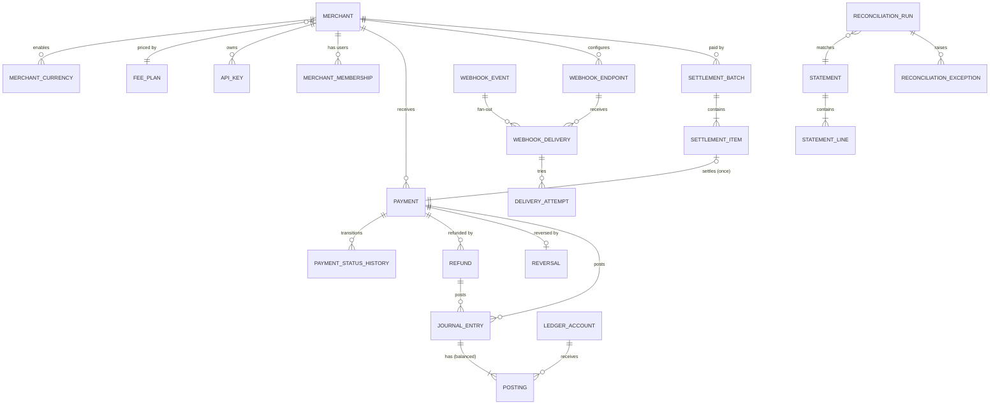

# PayFlow — Domain Model and Database Design

Status: **Phase 1 draft.** Column lists are the design intent; EF migrations in Phase 2+ are the
implementation and this document is updated alongside them.

## 1. Conventions

| Convention | Rule |
|---|---|
| Primary keys | `uuid`, generated as **UUIDv7** (`Guid.CreateVersion7`) — time-ordered, index friendly. |
| Public identifiers | Prefixed, opaque, immutable: `usr_`, `mer_`, `pay_`, `re_`, `rv_`, `evt_`, `we_`, `stl_`, `stmt_`, `rex_` + 26-char Crockford base32 of the UUID (`SharedKernel.Ids.PublicId`). They are **derived from the primary key, not stored**: the `public_id` entries in the tables below are computed, and lookups decode the id back to the UUID key. Never reveal sequence or volume. |
| Money | `numeric(19,4)` in PostgreSQL, `decimal` in C#, always paired with `currency char(3)`. Never `float`/`double`/`real`/`money`. |
| Time | `timestamptz`, written as UTC from `TimeProvider`. No `timestamp without time zone`. |
| Enums | Stored as `text` with a `CHECK (status IN (...))` constraint — readable in SQL, safe to extend by migration. |
| Concurrency | Mutable aggregates use PostgreSQL `xmin` as an EF concurrency token. |
| Append-only tables | Ledger, status history, audit, webhook attempts, statement lines: app DB role has `INSERT, SELECT` only, plus a `BEFORE UPDATE OR DELETE` trigger that raises. |
| Naming | `snake_case`, one schema per module. |

## 2. Domain model overview

### Aggregates and ownership

| Module | Aggregate roots | Invariants it protects |
|---|---|---|
| Merchants | `Merchant` (+ currencies, limits), `ApiKey`, `FeePlan` (immutable versions) | Status transitions; only active merchants transact; key secrets never stored in plaintext. |
| Payments | `Payment` (+ status history) | Legal state transitions; `refunded + pending_refund ≤ amount`; fee snapshot immutable after success. |
| Refunds | `Refund`, `Reversal` | Refund ≤ refundable balance; reversal only when eligible. |
| Ledger | `JournalEntry` (+ postings) | Σ debits = Σ credits per entry; single currency per entry; append-only; one entry per (source, entry type). |
| Webhooks | `WebhookEndpoint`, `WebhookEvent`, `WebhookDelivery` | One delivery per (event, endpoint); attempt numbering monotonic. |
| Settlement | `SettlementBatch` (+ items) | An item settles once; batch totals equal Σ items + carry-forward. |
| Reconciliation | `Statement`, `ReconciliationRun`, `ReconciliationException` | File imported once; exceptions deduplicated by fingerprint; resolution requires note. |

## 3. Schemas and tables

### `platform` (shared infrastructure)

**`currencies`** — `code char(3) PK`, `minor_units smallint CHECK (0..4)`, `display_name`, `is_enabled`.
Seed: ZAR (2), USD (2), EUR (2), GBP (2), JPY (0), KWD (3) — KWD and JPY deliberately exercise non-2 scales.

**`idempotency_records`**
| Column | Type | Notes |
|---|---|---|
| `scope` | text | `merchant:{id}` or `user:{id}` |
| `operation` | text | e.g. `payments.create`, `refunds.create` |
| `key` | text (≤ 255) | client-supplied |
| `request_hash` | bytea | SHA-256 of canonicalised request body + route params |
| `status` | text | `InProgress`, `Completed` |
| `response_status` | int null | |
| `response_body` | text null | exact body replayed on retry (text, not jsonb, so the replay is byte-identical) |
| `resource_type`, `resource_id` | text, uuid null | |
| `created_at`, `expires_at` | timestamptz | default retention 24 h (configurable) |
PK `(scope, operation, key)`.

**`outbox_messages`** — `id uuid PK`, `type`, `payload jsonb`, `occurred_at`, `correlation_id`, `processed_at null`, `attempts int`, `last_error`, index on `(processed_at) WHERE processed_at IS NULL`.
**`inbox_processed`** — `(message_id, handler) PK`, `processed_at` — makes every outbox handler idempotent.

### `identity`

ASP.NET Core Identity tables (`users`, `roles`, `user_roles`, `user_claims`, `user_tokens`…)
plus **`merchant_memberships`** — `user_id`, `merchant_id`, `role CHECK IN ('MerchantAdmin','MerchantOperator')`, PK `(user_id, merchant_id)`.
PlatformAdmin is a global Identity role. Data Protection key ring stored in `identity.data_protection_keys`.

### `merchants`

**`fee_plans`** (immutable once referenced; changes create a new version)
`id`, `name`, `version int`, `percentage_rate numeric(7,6) CHECK (0 ≤ rate < 1)`, `created_at`. UNIQUE `(name, version)`.

**`fee_plan_currency_terms`** — `fee_plan_id`, `currency`, `fixed_fee numeric(19,4) ≥ 0`, `min_payment_amount numeric(19,4) > 0`. PK `(fee_plan_id, currency)`.
Constraint (checked in domain): `min_payment_amount > fixed_fee` so a fee can never consume a whole payment.

**`merchants`**
`id`, `public_id UNIQUE`, `legal_name`, `trading_name`, `contact_email`, `country_code char(2)`,
`status CHECK IN ('PendingActivation','Active','Suspended','Closed')`, `fee_plan_id FK`,
`operator_refund_limit numeric(19,4) null`, `created_at`, `updated_at`, `xmin`.

**`merchant_currencies`** — `merchant_id`, `currency FK`, `max_payment_amount numeric(19,4)`, PK `(merchant_id, currency)`.

**`api_keys`**
`id`, `merchant_id FK`, `name`, `prefix varchar(8) UNIQUE` (shown in UI and logs), `secret_hash bytea` (HMAC-SHA256 with server pepper, `CHECK length = 32`),
`created_at`, `created_by`, `last_used_at` (written at most once a minute per key), `expires_at null` (set on rotation), `revoked_at null`, `replaced_by_key_id null`.

### `payments`

**`payments`**
| Column | Type | Constraint / note |
|---|---|---|
| `id` | uuid | PK |
| `public_id` | text | UNIQUE |
| `merchant_id` | uuid | FK, NOT NULL |
| `merchant_reference` | text | merchant's order id (not unique — merchants retry orders) |
| `amount` | numeric(19,4) | `CHECK (amount > 0)` |
| `currency` | char(3) | FK `platform.currencies` |
| `status` | text | `CHECK IN ('Created','Processing','Pending','Succeeded','Declined','Failed','Expired','PartiallyRefunded','Refunded','Reversed')` |
| `payment_method` | text | simulation token only, e.g. `sim_card_success` |
| `failure_code`, `failure_reason` | text null | required when status ∈ {Declined, Failed, Expired} |
| `fee_plan_id`, `fee_rate`, `fee_fixed` | snapshot at creation | immutable |
| `fee_amount` | numeric(19,4) null | set on success; `CHECK (fee_amount >= 0 AND fee_amount < amount)` |
| `refunded_amount` | numeric(19,4) | default 0, `≥ 0` |
| `pending_refund_amount` | numeric(19,4) | default 0, `≥ 0` |
| `idempotency_key` | text | UNIQUE `(merchant_id, idempotency_key)` — permanent second line of defence |
| `description`, `metadata jsonb` | | size-limited |
| `created_at`, `updated_at`, `processing_started_at`, `completed_at`, `simulated_resolve_at` | timestamptz | |
| `xmin` | | concurrency token |

Table-level: `CHECK (refunded_amount + pending_refund_amount <= amount)`.
Indexes: `(merchant_id, created_at DESC)`, `(merchant_id, status)`, `(status, simulated_resolve_at) WHERE status = 'Pending'`, `(merchant_id, merchant_reference)`.

**`payment_status_history`** (append-only) — `id bigint identity`, `payment_id`, `from_status null`, `to_status`, `reason`, `actor_type` (`Merchant`,`User`,`System`), `actor_id`, `correlation_id`, `occurred_at`.

### `refunds`

**`refunds`**
`id`, `public_id` (`re_`), `payment_id FK`, `merchant_id`, `amount > 0`, `currency` (must equal payment currency — domain + composite FK on `(payment_id, currency)`),
`status CHECK IN ('Pending','Succeeded','Failed')`, `reason`, `failure_reason`, `requested_by_type`, `requested_by_id`,
`idempotency_key`, UNIQUE `(merchant_id, idempotency_key)`, `created_at`, `completed_at`, `xmin`.

**`reversals`**
`id`, `public_id` (`rv_`), `payment_id FK UNIQUE` (at most one reversal per payment), `merchant_id`, `amount`, `fee_returned`, `status`, `reason`, `requested_by_*`, `idempotency_key`, `created_at`, `completed_at`.

### `ledger` (append-only, double entry)

**`accounts`** — `id`, `code UNIQUE` (e.g. `merchant_payable:mer_…:ZAR`), `type CHECK IN ('Asset','Liability','Revenue','Expense')`, `merchant_id null`, `currency`, `created_at`.

| Account | Type | Normal balance | Meaning |
|---|---|---|---|
| `acquirer_receivable:{ccy}` | Asset | Debit | Funds the simulated acquirer owes PayFlow for captured payments. |
| `merchant_payable:{merchant}:{ccy}` | Liability | Credit | What PayFlow owes the merchant. |
| `fee_revenue:{ccy}` | Revenue | Credit | PayFlow processing fees. |
| `payout_cash:{ccy}` | Asset | Debit | Simulated PayFlow bank account paying settlements. |
| `reconciliation_suspense:{ccy}` | Asset | Debit | Holds approved reconciliation adjustments. |

**`journal_entries`** — `id`, `entry_type` (`PaymentCaptured`, `PaymentFee`, `RefundSucceeded`, `PaymentReversed`, `SettlementPaid`, `ReconciliationAdjustment`), `source_type`, `source_id`, `currency`, `description`, `occurred_at`, `correlation_id`.
UNIQUE `(source_type, source_id, entry_type)` → a business event can never be posted twice.

**`postings`** — `id bigint identity`, `journal_entry_id FK`, `account_id FK`, `direction CHECK IN ('D','C')`, `amount numeric(19,4) CHECK (amount > 0)`.
A **deferred constraint trigger** verifies at commit that each journal entry's debits equal its credits and that all postings share the entry's currency.

Account balances are computed from postings (indexed by `account_id`); a cached `account_balances` table may be added later, maintained in the same transaction, if reporting needs it.

### `webhooks`

**`endpoints`** — `id`, `public_id` (`we_`), `merchant_id`, `url`, `description`, `event_types text[]`, `is_enabled`,
`secret_ciphertext bytea`, `secret_hint` (last 4), `secret_rotated_at`, `previous_secret_ciphertext null`, `previous_secret_expires_at null` (dual-sign during rotation), `created_at`, `updated_at`.

**`events`** — `id`, `public_id` (`evt_`), `merchant_id`, `type`, `api_version`, `payload jsonb`, `occurred_at`, `source_message_id UNIQUE` (outbox id → exactly one event per domain change).

**`deliveries`** — `id`, `event_id`, `endpoint_id`, `status CHECK IN ('Pending','Retrying','Succeeded','Exhausted','Cancelled')`, `attempt_count`, `next_attempt_at`, `last_attempt_at`, `succeeded_at`. UNIQUE `(event_id, endpoint_id)`. Index `(next_attempt_at) WHERE status IN ('Pending','Retrying')`.

**`delivery_attempts`** (append-only) — `id`, `delivery_id`, `attempt_number`, `started_at`, `duration_ms`, `request_headers jsonb` (signature redacted), `response_status null`, `response_body_excerpt` (≤ 2 KB), `error_kind` (`Timeout`,`ConnectionRefused`,`Non2xx`,`TlsError`,`SsrfBlocked`), `error_message`. UNIQUE `(delivery_id, attempt_number)`.

### `settlement`

**`batches`**
`id`, `public_id` (`stl_`), `merchant_id`, `currency`, `cutoff_at`, `status CHECK IN ('Pending','Paid','Failed')`,
`gross_payments`, `total_fees`, `total_refunds`, `carried_forward_in`, `net_amount`, `payout_amount`, `carried_forward_out` (all `numeric(19,4)`),
`created_at`, `created_by`, `paid_at`, `failure_reason`, `idempotency_key`.
Checks: `payout_amount >= 0`, `carried_forward_out <= 0`, `payout_amount + carried_forward_out = net_amount`.
Partial UNIQUE `(merchant_id, currency) WHERE status = 'Pending'` — only one open batch per merchant/currency.

**`items`** — `id`, `batch_id FK`, `item_type CHECK IN ('Payment','Refund')` (reversed payments are never settled — see PAYMENT_LIFECYCLE.md R8), `source_id`, `gross_amount`, `fee_amount`, `net_amount`.
**UNIQUE `(item_type, source_id)`** → a transaction can never be settled twice, regardless of application bugs or concurrent runs.

### `reconciliation`

**`statements`** — `id`, `public_id` (`stmt_`), `source_name`, `period_start`, `period_end`, `file_name`, `file_sha256 bytea UNIQUE`, `line_count`, `imported_by`, `imported_at`, `status` (`Imported`,`Reconciled`).

**`statement_lines`** (append-only) — `id`, `statement_id`, `line_number`, `external_id`, `payflow_reference null`, `transaction_type` (`PAYMENT`,`REFUND`), `amount`, `currency`, `external_status`, `value_date`, `raw jsonb`, `parse_errors jsonb null`. UNIQUE `(statement_id, line_number)`.

**`runs`** — `id`, `statement_id`, `started_at`, `completed_at`, `started_by`, counts per outcome.

**`results`** — `id`, `run_id`, `statement_line_id null`, `internal_type null`, `internal_id null`, `outcome` (`Matched`,`MissingExternal`,`MissingInternal`,`AmountMismatch`,`CurrencyMismatch`,`DuplicateExternal`,`StatusDiscrepancy`), `internal_amount`, `external_amount`, `details jsonb`.

**`exceptions`** — `id`, `public_id` (`rex_`), `fingerprint bytea UNIQUE` (hash of outcome + internal id + external id → reruns never duplicate), `outcome`, `statement_id`, `latest_result_id`, `status CHECK IN ('Open','InReview','Resolved','Dismissed')`, `assigned_to`, `resolution_type` (`AcceptedExternal`,`AcceptedInternal`,`AdjustmentPosted`,`ExternalCorrectionRequested`,`FalsePositive`), `resolution_note`, `resolved_by`, `resolved_at`, `created_at`, `xmin`.
**`exception_history`** (append-only) — status changes and comments.

### `audit`

**`audit_events`** (append-only) — `id bigint identity`, `occurred_at`, `actor_type`, `actor_id`, `actor_display`, `merchant_id null`, `action` (e.g. `merchant.api_key.rotated`), `target_type`, `target_id`, `changes jsonb` (redacted before/after), `ip_address inet`, `user_agent`, `correlation_id`.
Indexes: `(merchant_id, occurred_at DESC)`, `(target_type, target_id)`.

### `reporting`

Phase 8 starts with indexed SQL queries/views over the module tables, cached in Redis for 60 s.
If they become slow, add `daily_merchant_stats` rolled up by a worker (append on day close, recomputable from source).

## 4. Database roles

| Role | Rights |
|---|---|
| `payflow_migrator` | Owns all objects, runs DDL; used only by the `migrate` job. |
| `payflow_app` | DML on mutable tables; `INSERT, SELECT` only on append-only tables; no DDL. |
| `payflow_readonly` | `SELECT` on `reporting` views (future BI use; not yet created). |

Implementation: [`deploy/postgres/sql/roles.sql`](../deploy/postgres/sql/roles.sql) creates `payflow_app` and
default privileges; each migration that creates an append-only table calls
`AppendOnlySql.Protect(schema, table)`, which adds the rejecting trigger and revokes
`UPDATE, DELETE, TRUNCATE` from `payflow_app`. The integration tests apply the same SQL and run
the API as `payflow_app`, so these guarantees are tested, not assumed.

## 5. Implementation status

| Schema | Tables in place | Phase |
|---|---|---|
| `platform` | `currencies` (seeded), `outbox_messages`, `ef_migrations_history` | 2 ☑ |
| `identity` | ASP.NET Identity tables, `merchant_memberships`, `data_protection_keys` | 2 ☑ |
| `audit` | `audit_events` (append-only) | 2 ☑ |
| `platform` | `idempotency_records` | 4 ☑ |
| `ledger` | `accounts`, `journal_entries`, `postings` (all append-only; deferred constraint triggers check balance, posting count and currency at commit) | 4 ☑ |
| `payments` | `payments` (checks for fee, refund balance, failure code; FKs to merchant and fee plan), `payment_status_history` (append-only) | 4 ☑ |
| `platform` | `inbox_processed` (one row per message and handler) | 6 ☑ |
| `merchants` | `merchants`, `merchant_currencies`, `fee_plans` + `fee_plan_currency_terms` (append-only, Standard v1 seeded), `api_keys`; deferred FK from `identity.merchant_memberships` | 3 ☑ |
| `refunds` | `refunds` (status checks, `completed_at` iff final, unique key per merchant, no delete), `reversals` (one per payment, immutable, no delete); FKs to payments and merchants; `payments.payments` now also rejects delete | 5 ☑ |
| `webhooks` | `endpoints` (secret AES-GCM encrypted, no delete), `events` (immutable, body stored as text, unique per outbox message), `deliveries` (one per event and endpoint, no delete), `delivery_attempts` (immutable) | 6 ☑ |
| `settlement`, `reconciliation` | — | 7 |
