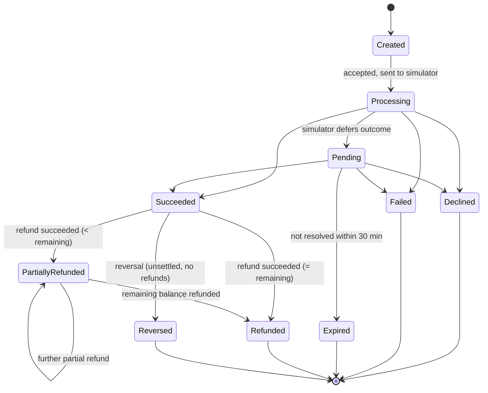
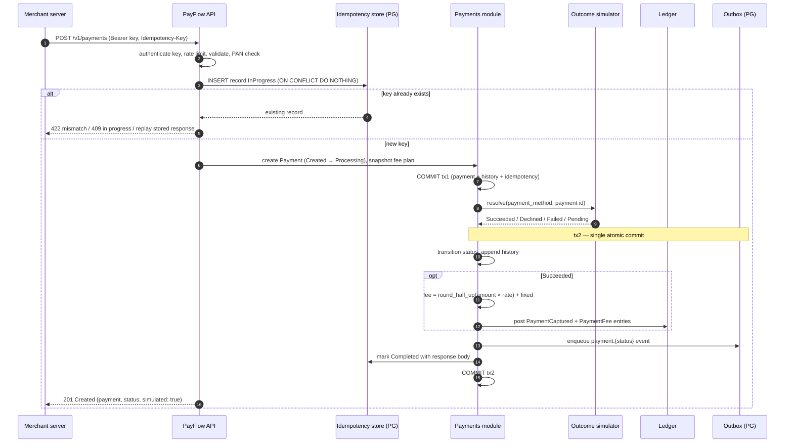

# PayFlow — Payment Lifecycle and Financial Rules

Status: **Phase 1 draft.** This document is normative: code and tests must match it, and any
change to a rule here is a reviewed change.

---

## 1. Money rules

| # | Rule |
|---|---|
| M1 | Monetary values are `decimal` in C# and `numeric(19,4)` in PostgreSQL. `float`, `double`, `real` and the Postgres `money` type are forbidden (enforced by an architecture test + code review). |
| M2 | Every amount travels with an explicit ISO 4217 currency code. Arithmetic between different currencies throws. `Money` is an immutable value object in `SharedKernel`. |
| M3 | Each currency has defined minor units (ZAR/USD/EUR/GBP 2, JPY 0, KWD 3). |
| M4 | **Client amounts are never rounded.** An amount with more decimals than the currency allows is rejected (`400 amount_precision_exceeded`). |
| M5 | Rounding happens **only** at defined calculation points (fee calculation), once, to the currency's minor units, using `MidpointRounding.AwayFromZero` (commercial "half-up"). Results are stored; they are never recomputed later. |
| M6 | On the API, amounts are **decimal strings** (`"amount": "100.00"`) so JavaScript clients cannot introduce binary-float error. The Angular app formats but never does money arithmetic. |
| M7 | All timestamps are UTC (`timestamptz`), from an injected `TimeProvider`. Business dates (settlement cut-off, report days) are UTC days. |

## 2. Fee rules

Each merchant references an immutable, versioned **fee plan**: a percentage rate plus a fixed fee
and minimum payment amount per currency. The plan is **snapshotted onto the payment at creation**,
so later plan changes never alter historical fees.

```
percentage_component = round_half_up(amount × rate, minor_units)
fee                  = percentage_component + fixed_fee(currency)
invariant            : 0 ≤ fee < amount   (guaranteed because min_payment_amount > fixed_fee and rate < 1)
```

| Example | Amount | Rate | Fixed | % component (exact → rounded) | Fee | Net to merchant |
|---|---|---|---|---|---|---|
| A | ZAR 100.00 | 2.9 % | 2.00 | 2.900 → 2.90 | 4.90 | 95.10 |
| B | ZAR 250.00 | 2.9 % | 2.00 | 7.250 → 7.25 | 9.25 | 240.75 |
| C | ZAR 19.99 | 2.9 % | 2.00 | 0.57971 → 0.58 | 2.58 | 17.41 |
| D | ZAR 0.50 … rejected | — | — | below min payment ZAR 5.00 | — | — |
| E | JPY 1000 | 2.9 % | 30 | 29.0 → 29 | 59 | 941 |
| F | KWD 12.345 | 2.9 % | 0.100 | 0.358005 → 0.358 | 0.458 | 11.887 |

- The fee is recognised when the payment **succeeds** (not when it is created).
- **Refunds do not return fees.** The merchant bears the original processing fee (common industry policy; documented and shown in the UI).
- **Reversals return the full fee**, because a reversal cancels the payment before it was ever settled.

## 3. Payment state machine



- Transitions are a whitelist inside the `Payment` aggregate (`Payment.TransitionTo` throws `InvalidStateTransition` for anything else). A table-driven unit test covers **every** pair of states.
- Every transition appends a `payment_status_history` row (from, to, reason, actor, correlation id) in the same transaction.
- `Declined` = the (simulated) issuer said no — a business outcome. `Failed` = technical failure (processor error/timeout). Both require `failure_code` + `failure_reason`.
- A `Processing` payment older than 60 s is picked up by a **recovery worker**, which re-queries the deterministic simulator and completes it — so a crash mid-request never leaves money in limbo.

### Simulated payment methods (`payment_method`)

| Token | Outcome |
|---|---|
| `sim_card_success` | Succeeded |
| `sim_card_declined_insufficient_funds` | Declined `insufficient_funds` |
| `sim_card_declined_do_not_honour` | Declined `do_not_honour` |
| `sim_card_processor_error` | Failed `processor_error` |
| `sim_card_pending` | Pending → Succeeded after ~10 s |
| `sim_card_pending_then_declined` | Pending → Declined after ~10 s |
| `sim_card_pending_expires` | Pending → Expired after 30 min (shortened in tests via fake time) |
| `sim_card_refund_fails` | Succeeded; refunds against it fail |

Any other value is rejected. Strings that look like card numbers (Luhn-valid 13–19 digits) are rejected everywhere with a message explaining PayFlow is a simulation.

## 4. Refund and reversal rules

```
refundable_balance = amount − refunded_amount − pending_refund_amount
```

| # | Rule |
|---|---|
| R1 | Refunds allowed only when payment status ∈ {Succeeded, PartiallyRefunded}. |
| R2 | `0 < refund.amount ≤ refundable_balance`, same currency, same precision rules as payments. |
| R3 | Creating a refund **reserves** the amount (`pending_refund_amount += r`) so concurrent refunds cannot oversubscribe. DB check `refunded_amount + pending_refund_amount ≤ amount` is the final guard. |
| R4 | Refund creation locks the payment row (`SELECT … FOR UPDATE`) — contention per payment is expected, and serialising is cheaper than optimistic retries here. |
| R5 | Refund `Pending → Succeeded`: `pending −= r`, `refunded += r`, payment → PartiallyRefunded/Refunded, ledger entry, outbox event — one transaction. `Pending → Failed`: `pending −= r` only. |
| R6 | Merchant Operators may refund up to the merchant's `operator_refund_limit` for that currency, per refund; above that requires a MerchantAdmin. A currency with no operator limit means operators cannot refund it. MerchantAdmins and the merchant's API keys have no per-refund limit. PlatformAdmins can view refunds but cannot create refunds or reversals: moving a merchant's money is the merchant's decision. |
| R7 | Refunds of already-settled payments are allowed; they appear as negative items in the next settlement. |
| R8 | **Reversal** = full cancellation, allowed only if status = Succeeded, `refunded_amount = 0`, `pending_refund_amount = 0`, and the payment is in no settlement batch. Reversed payments are never settled. Reversal locks the payment row, the same as settlement, so the two cannot race. |
| R9 | Nothing is ever deleted. A refund or reversal is a new record + new ledger entry referencing the original payment. Payments, refunds and reversals reject `DELETE`/`TRUNCATE` by trigger and the app role has no `DELETE` privilege; reversals also reject `UPDATE`. |
| R10 | A refund request without `amount` refunds the whole remaining refundable balance. |
| R11 | Refunds are created `Pending` in one transaction and completed by the refund processor (every 2 s), which takes the same payment row lock. Simulated outcome: payments made with `sim_card_refund_fails` have their refunds fail; all others succeed. |
| R12 | Reversals are synchronous and return `201` with the reversal. Until Phase 7 adds settlement, no payment counts as settled; Phase 7 replaces `ISettlementLookup` with the real check. |

## 5. Ledger postings

Double-entry, append-only. Each business event produces exactly one journal entry per entry type
(unique `(source_type, source_id, entry_type)`); debits equal credits, checked at commit.

| Event | Debit | Credit | Amount |
|---|---|---|---|
| Payment succeeded | `acquirer_receivable` | `merchant_payable` | gross |
| Payment fee | `merchant_payable` | `fee_revenue` | fee |
| Refund succeeded | `merchant_payable` | `acquirer_receivable` | refund |
| Payment reversed | `merchant_payable` | `acquirer_receivable` | gross |
| Reversal fee return | `fee_revenue` | `merchant_payable` | fee |
| Settlement paid | `merchant_payable` | `payout_cash` | payout |
| Reconciliation adjustment | `reconciliation_suspense` ↔ affected account | | approved amount |

**Invariant tested continuously:** for every merchant and currency,
`balance(merchant_payable) = Σ unsettled (gross − fee) − Σ unsettled refunds − carried-forward deficit`.

## 6. Settlement rules

| # | Rule |
|---|---|
| S1 | Run per (merchant, currency) with a cut-off (default: start of current UTC day → T+1). |
| S2 | Eligible items: payments with status ∈ {Succeeded, PartiallyRefunded, Refunded} and `completed_at < cutoff`; refunds with status Succeeded and `completed_at < cutoff`; in both cases **not already in a batch**. Reversed, declined, failed, pending and expired payments are never eligible. |
| S3 | `net = Σ payment gross − Σ payment fees − Σ refunds + carried_forward_in` |
| S4 | `payout = max(net, 0)`; `carried_forward_out = min(net, 0)` — a deficit (e.g. refunds exceeding new sales) rolls into the next batch rather than producing a negative payout. |
| S5 | An item can be in at most one batch — `UNIQUE (item_type, source_id)` makes double settlement impossible even under concurrent runs. A Postgres advisory lock per (merchant, currency) prevents wasted concurrent attempts. |
| S6 | Batch `Pending → Paid` posts the `SettlementPaid` ledger entry. `Pending → Failed` posts nothing; a failed batch is retried as-is and is never re-composed (items stay bound to it). |
| S7 | A batch with zero eligible items is not created. |

**Worked example** (examples A, B, C above; one ZAR 40.00 refund on A; no carry-forward):

| Line | Gross | Fee | Net |
|---|---|---|---|
| Payment A | 100.00 | 4.90 | 95.10 |
| Payment B | 250.00 | 9.25 | 240.75 |
| Payment C | 19.99 | 2.58 | 17.41 |
| Refund on A | −40.00 | 0.00 | −40.00 |
| **Batch** | **329.99** | **16.73** | **313.26** → payout ZAR 313.26 |

## 7. Idempotency

`Idempotency-Key` (1–255 printable chars) is **required** on `POST /v1/payments`, `POST /v1/payments/{id}/refunds` and `POST /v1/payments/{id}/reversal`; dashboard writes that move money use a key generated by the SPA.

Algorithm (key scope = merchant + operation):

1. Compute `request_hash = SHA-256(method + route + canonical JSON body)` (keys sorted, whitespace-free).
2. `INSERT INTO idempotency_records … ON CONFLICT DO NOTHING` with status `InProgress`, committed **before** any financial work. The primary key guarantees exactly one winner among concurrent requests.
3. If the insert lost, load the existing record:
   | Existing record | Response |
   |---|---|
   | different `request_hash` | `422 idempotency_key_reused` |
   | `InProgress` | `409 idempotency_request_in_progress` + `Retry-After: 1` |
   | `Completed` | replay stored status + body, header `Idempotent-Replayed: true` |
4. Winner executes; the final business transaction also marks the record `Completed` with the response.
5. Rejections **before** the payment exists (`400` validation, `422` merchant inactive, currency not enabled, amount outside limits) and unexpected errors before transaction 1 **release** the key, so the client can correct the request and retry with the same key. Once the payment row exists the key is never released: business outcomes (declined, failed, pending) are `Completed` and replayed, and a crash leaves it `InProgress` until recovery completes it.
6. Records expire after 24 h (configurable); the permanent `UNIQUE (merchant_id, idempotency_key)` on payments/refunds still prevents a duplicate after expiry (returns `409 duplicate_idempotency_key`).
7. A replay returns the **original** response byte for byte, stored as text, with `Idempotent-Replayed: true`. A payment that was `Pending` when created replays as `Pending` even after it resolves; use `GET /v1/payments/{id}` for the current state.

## 8. Concurrency strategy

| Scenario | Mechanism | Test |
|---|---|---|
| Duplicate payment requests | Idempotency PK + unique key on payments | 50 parallel identical requests → 1 payment, 49 replays/409s |
| Concurrent refunds on one payment | `FOR UPDATE` row lock + reservation + DB check | 20 parallel ZAR 10 refunds on ZAR 100 → exactly 10 succeed |
| Refund vs. pending-resolution / status update | `xmin` optimistic concurrency, retry ×3 | forced interleaving test |
| Reversal vs. settlement | both lock payment row; settlement unique constraint | parallel run test |
| Concurrent settlement runs | advisory lock + `UNIQUE (item_type, source_id)` | two parallel runs → one batch |
| Multiple worker instances | `FOR UPDATE SKIP LOCKED` | two dispatchers, no duplicate sends |

Isolation level: **Read Committed** (Postgres default) combined with explicit row locks, optimistic
tokens and constraints. Serializable is not used globally; it would add retry complexity without
covering anything the explicit controls do not.

## 9. Sequence diagrams

### 9.1 Payment initiation



### 9.2 Refund processing

```mermaid
sequenceDiagram
    autonumber
    participant U as Merchant (API or dashboard)
    participant API as PayFlow API
    participant REF as Refunds module
    participant DB as PostgreSQL
    participant W as Refund processor (worker)
    participant LED as Ledger
    participant OB as Outbox

    U->>API: POST /v1/payments/{id}/refunds {amount, reason} + Idempotency-Key
    API->>API: authN/authZ (operator limit), validate, idempotency claim
    API->>REF: CreateRefund
    REF->>DB: BEGIN; SELECT payment FOR UPDATE
    REF->>REF: check status ∈ {Succeeded, PartiallyRefunded}<br/>check amount ≤ amount − refunded − pending
    alt exceeds refundable balance / invalid state
        REF-->>API: 422 refund_exceeds_refundable_balance / invalid_payment_state
    else valid
        REF->>DB: INSERT refund Pending; pending_refund_amount += r; audit; COMMIT
        API-->>U: 201 refund (Pending)
        W->>DB: pick Pending refund (SKIP LOCKED), simulate outcome
        alt simulated success
            W->>DB: BEGIN; refund → Succeeded; pending −= r; refunded += r
            W->>DB: payment → PartiallyRefunded or Refunded (+ history)
            W->>LED: post RefundSucceeded entry
            W->>OB: refund.succeeded
            W->>DB: COMMIT
        else simulated failure
            W->>DB: refund → Failed; pending −= r; outbox refund.failed; COMMIT
        end
    end
```

### 9.3 Webhook delivery

```mermaid
sequenceDiagram
    autonumber
    participant OB as Outbox dispatcher
    participant WH as Webhooks module
    participant DB as PostgreSQL
    participant S as Webhook sender
    participant R as Merchant endpoint

    OB->>DB: SELECT unprocessed outbox FOR UPDATE SKIP LOCKED
    OB->>WH: handle(message) [inbox dedupe on message id]
    WH->>DB: INSERT event evt_… (UNIQUE source_message_id)
    WH->>DB: INSERT delivery per subscribed, enabled endpoint (UNIQUE event+endpoint)
    OB->>DB: mark outbox processed; COMMIT
    loop until Succeeded or 8 attempts
        S->>DB: claim due delivery (SKIP LOCKED), attempt_count += 1
        S->>S: t = now; sig = HMAC-SHA256(secret, t + "." + body)
        S->>R: POST body<br/>PayFlow-Signature: t=…,v1=…<br/>PayFlow-Event-Id: evt_…
        alt 2xx within 10 s
            R-->>S: 200
            S->>DB: attempt row; delivery → Succeeded
        else timeout / non-2xx / connection error
            R-->>S: error
            S->>DB: attempt row (redacted); delivery → Retrying,<br/>next_attempt_at = now + backoff ± 20 % jitter
        end
    end
    Note over S,DB: after attempt 8 → Exhausted; merchant can redeliver manually
    Note over R: receiver verifies signature, rejects |now − t| > 5 min,<br/>dedupes on event id, returns 2xx fast
```

**Retry schedule** (delay after each failed attempt): 1 min, 5 min, 30 min, 2 h, 5 h, 10 h, 10 h → 8 attempts over ≈ 28 h.
**Ordering** is not guaranteed; payloads carry `occurred_at` and a resource snapshot, and receivers should fetch the latest state if order matters.
**Secret rotation** signs with both old and new secrets (two `v1=` values) for 24 h.

**Details as built (Phase 6)**

- `v1 = lowercase hex(HMAC-SHA256(key = UTF-8(secret), message = UTF-8("{t}.{raw body}")))`, `t` in Unix seconds. Example: secret `whsec_test_secret_123`, `t=1731405600`, body `{"id":"evt_1","type":"payment.succeeded"}` gives `c87b9fbc01cb589c867c7f34e13638fc8af978018c333066f38c906e709dc652`.
- `src/PayFlow.Webhooks.Signature` is a dependency-free library that signs and verifies (with the 5-minute replay window); merchants' receivers can use it as-is.
- Headers: `PayFlow-Signature`, `PayFlow-Event-Id`, `PayFlow-Event-Type`, `PayFlow-Delivery-Id`, `PayFlow-Delivery-Attempt`, `X-Correlation-Id`.
- Body: `{ id, object: "event", type, apiVersion, createdAt, livemode: false, simulated: true, data }`, identical bytes on every attempt.
- Success means any 2xx within 10 s. Redirects are not followed. Everything else (non-2xx, timeout, connection failure, SSRF block) is retried.
- Delivery is **at least once**: a sender that crashes after sending but before recording re-sends once its 60-second claim lease expires. Receivers must de-duplicate on the event id.
- A disabled endpoint's pending deliveries are cancelled. Manual redelivery restarts the 8-attempt budget.

## 10. Reconciliation matching rules (summary — expanded in RECONCILIATION.md, Phase 7)

Input: one imported statement (CSV: `external_id, payflow_reference, type, amount, currency, status, value_date`).
Internal scope: payments and refunds with `completed_at` in the statement period.

1. Group statement lines by `(type, payflow_reference)`. The first line in each group is evaluated; extra lines → **DuplicateExternal**.
2. For each evaluated line, look up the internal record by reference (regardless of period). Precedence of outcomes:
   **MissingInternal** (no record) → **CurrencyMismatch** → **AmountMismatch** (exact, zero tolerance) → **StatusDiscrepancy** (status mapping table) → **Matched**.
3. Each in-scope internal record that no line matched → **MissingExternal**.
4. Every non-matched result becomes an exception with a deterministic fingerprint, so rerunning the same statement updates existing exceptions instead of duplicating them.
5. Exceptions: `Open → InReview → Resolved | Dismissed`; resolution needs a type and note. `AdjustmentPosted` creates a `ReconciliationAdjustment` ledger entry and requires PlatformAdmin.
