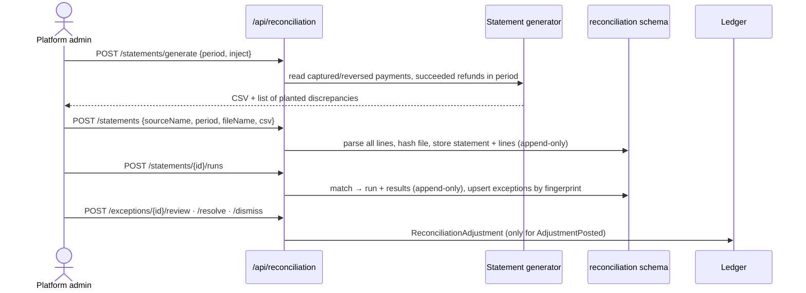
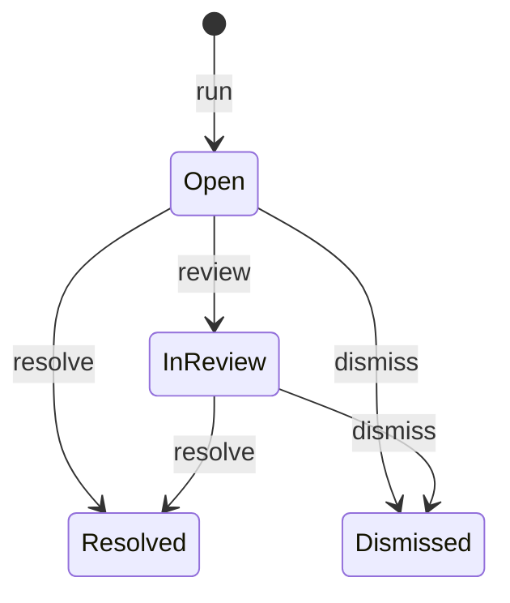

# PayFlow — Reconciliation

Status: **built in Phase 7.** The acquirer is simulated; its statements are generated by PayFlow
itself, with discrepancies planted on request so every outcome can be demonstrated.

Reconciliation compares what the (simulated) acquirer says happened with what PayFlow recorded,
and turns every disagreement into an exception that a platform operator works to a conclusion.
All endpoints require **PlatformAdmin**.

## 1. Flow



## 2. Statement format

UTF-8 CSV with this exact header. Fields are plain values; quoting is not supported.

```
external_id,payflow_reference,type,amount,currency,status,value_date
SIM-PAY_01M7…,pay_01m7…,PAYMENT,251.00,ZAR,CAPTURED,2026-11-18
SIM-RE_01M7…,re_01m7…,REFUND,40.00,ZAR,REFUNDED,2026-11-18
```

| Field | Rule |
|---|---|
| `external_id` | Acquirer's id, 1–100 characters |
| `payflow_reference` | The PayFlow public id (`pay_…` or `re_…`), 1–100 characters |
| `type` | `PAYMENT` or `REFUND` |
| `amount` | Positive, at most the currency's minor units (`10.001` ZAR is invalid) |
| `currency` | A supported ISO code |
| `status` | `PAYMENT`: `CAPTURED`, `REVERSED`, `DECLINED`, `FAILED` · `REFUND`: `REFUNDED`, `FAILED` |
| `value_date` | `yyyy-MM-dd` |

**Import** (`POST /statements`, REC-1) is all or nothing. A file with any bad line is rejected with
`400 invalid_statement`, listing every error by line (up to 50), and nothing is stored. The SHA-256
of the file is unique: the same file twice gives `409 statement_already_imported`. At most 50,000
lines and 5 MB.

**Generator** (`POST /statements/generate`, at most 31 days): writes the statement the acquirer
would send for the period, from PayFlow's records, then plants the requested discrepancies (each
0–100), taking records in completion order:

| Inject | How |
|---|---|
| `missingExternal` | record left off the statement |
| `amountMismatch` | amount reported one unit higher |
| `currencyMismatch` | reported in another currency that fits the amount's precision |
| `statusDiscrepancy` | `CAPTURED`↔`REVERSED`, or a refund reported `FAILED` |
| `duplicateExternal` | record reported twice (second line `…-DUP`) |
| `missingInternal` | a line for a `pay_…` id PayFlow never issued |

It returns the CSV, the file name and the list of planted discrepancies; it does not import. If the
period has fewer records than the injections need: `422 not_enough_transactions`.

## 3. Matching (REC-3)

**Internal scope** is what the acquirer is expected to report: payments that were captured
(`Succeeded`, `PartiallyRefunded`, `Refunded`) or `Reversed`, and `Succeeded` refunds, with
`completed_at` in `[period_start, period_end + 1 day)` UTC. Declined, failed and expired payments
never reached the acquirer's books, so their absence is not a discrepancy.

1. Lines are grouped by `(type, payflow_reference)` in file order. The first line of each group is
   evaluated; every further line is **DuplicateExternal**.
2. Each evaluated line is looked up by reference, regardless of period, and classified by the first
   rule that applies:

   | Precedence | Outcome | When |
   |---|---|---|
   | 1 | **MissingInternal** | no PayFlow record (unknown id, wrong prefix for the type, or not an id) |
   | 2 | **CurrencyMismatch** | currencies differ |
   | 3 | **AmountMismatch** | amounts differ at all (zero tolerance) |
   | 4 | **StatusDiscrepancy** | statuses disagree (table below) |
   | 5 | **Matched** | everything agrees |

3. Each in-scope record that no line referred to is **MissingExternal**.

Status mapping:

| PayFlow | Statement agrees if |
|---|---|
| Payment `Succeeded`, `PartiallyRefunded`, `Refunded` | `CAPTURED` |
| Payment `Reversed` | `REVERSED` |
| Payment `Declined`, `Failed`, `Expired` | `DECLINED` or `FAILED` |
| Refund `Succeeded` | `REFUNDED` |
| Refund `Failed` | `FAILED` |
| anything `Pending`/`Processing` | never (still in flight) |

The engine (`ReconciliationEngine`) is pure, with no database or HTTP, so these rules are
unit-tested directly.

## 4. Runs are repeatable (REC-5)

`POST /statements/{id}/runs` takes an advisory lock per statement, stores a **run** with counts per
outcome and one **result** per line or missing record (both kept forever: every run is evidence),
and then raises exceptions for every non-matched result.

Each exception has a **fingerprint**: SHA-256 of statement id, outcome, internal type and id, line
type and reference, plus the line number for `DuplicateExternal` and `MissingInternal`. It is
`UNIQUE`, so a rerun finds the existing exception and updates it (`timesSeen`, latest result,
amounts) instead of adding another. Closed exceptions stay closed. A rerun of an unchanged statement
reports `exceptionsCreated: 0` and `exceptionsSeenAgain` equal to the discrepancy count.

The same discrepancy in two different statements (for example overlapping periods) is two
exceptions, one per statement.

## 5. Exception workflow (REC-4)



| Action | Body | Notes |
|---|---|---|
| `POST /exceptions/{id}/review` | `{ note? }` | assigns it to the caller |
| `POST /exceptions/{id}/resolve` | `{ resolutionType, note }` | `AcceptedExternal`, `AcceptedInternal` or `ExternalCorrectionRequested` |
| `POST /exceptions/{id}/resolve` | `{ resolutionType: "AdjustmentPosted", note, adjustment: { amount, direction } }` | posts a ledger adjustment (below) |
| `POST /exceptions/{id}/dismiss` | `{ note }` | resolution type `FalsePositive` |

A note is always required to close an exception. Every change appends to `exception_history` and
the audit log. Changes take a row lock, and the row version (`xmin`) catches anything that slips
past it (`409 concurrent_update`). An invalid move is `422 invalid_exception_transition`.

**Adjustments.** `AdjustmentPosted` posts one `ReconciliationAdjustment` journal entry, in the
exception's currency (the statement's, or PayFlow's for a missing line), in the same transaction as
the resolution:

| `direction` | Debit | Credit | Meaning |
|---|---|---|---|
| `IncreaseReceivable` | `acquirer_receivable` | `reconciliation_suspense` | the acquirer owes more than PayFlow recorded |
| `DecreaseReceivable` | `reconciliation_suspense` | `acquirer_receivable` | the acquirer owes less |

The ledger's unique source key (`reconciliation_exception`, exception id) allows one adjustment per
exception. Merchant balances are never touched by reconciliation: the suspense account holds the
difference until it is explained.

## 6. Storage

Schema `reconciliation` ([DATABASE.md](DATABASE.md)): `statements`, `statement_lines`
(append-only), `runs`, `results` (append-only), `exceptions`, `exception_history` (append-only).
Statements, runs and exceptions can change state but never be deleted.

## 7. Limits

- One acquirer format; no SFTP or scheduled imports. Statements arrive through the API.
- Matching is by PayFlow reference only; there is no fuzzy matching on amount and date.
- Exceptions are not closed automatically when the underlying data is later corrected; an operator
  closes them, with a note.
