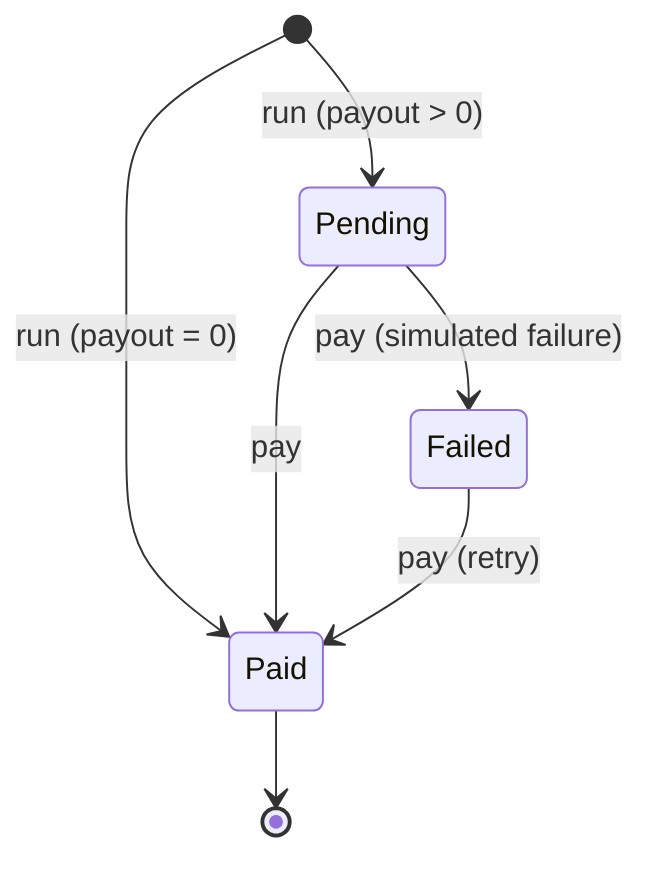

# PayFlow — Settlement

Status: **built in Phase 7.** Every payout is simulated: no money moves and no bank is contacted.

Settlement answers one question per merchant and currency: *how much does PayFlow owe this
merchant for the transactions completed before the cut-off, and has it been paid?* The rules are
numbered S1–S7 in [PAYMENT_LIFECYCLE.md §6](PAYMENT_LIFECYCLE.md); this document explains how the
module applies them.

## 1. What goes into a batch

| Item | Eligible when (S2) | Contributes |
|---|---|---|
| Payment | status `Succeeded`, `PartiallyRefunded` or `Refunded`; `completed_at < cutoff`; not in a batch | `+ gross − fee` |
| Refund | status `Succeeded`; `completed_at < cutoff`; not in a batch | `− amount` |

Reversed, declined, failed, pending and expired payments are never settled. A payment's refunds
settle on their own: a payment refunded after it was settled stays in its batch, and the refund
lands in the next one.

```
net        = Σ gross − Σ fees − Σ refunds + carried_forward_in     (S3)
payout     = max(net, 0)                                            (S4)
carry_out  = min(net, 0)
```

**Worked example** (payments A, B, C; one ZAR 40.00 refund on A; nothing carried in):

| Line | Gross | Fee | Net |
|---|---|---|---|
| Payment A | 100.00 | 4.90 | 95.10 |
| Payment B | 250.00 | 9.25 | 240.75 |
| Payment C | 19.99 | 2.58 | 17.41 |
| Refund on A | −40.00 | | −40.00 |
| **Batch** | | **16.73** | **313.26** → payout ZAR 313.26 |

Reproduced by `SettlementComposeTests`, by the `SettlementTests` integration test through the API
and ledger, and on the Compose stack.

## 2. Carry-forward

A batch whose refunds exceed its sales pays nothing and carries the deficit forward:

| Batch | Contents | Net | Payout | Carried out |
|---|---|---|---|---|
| 1 | payment 100.00 (fee 4.90) | 95.10 | 95.10 | 0.00 |
| 2 | refund 100.00 of that payment | −100.00 | 0.00 (auto-`Paid`, reference `NO-PAYOUT`) | −100.00 |
| 3 | payment 150.00 (fee 6.35), −100.00 carried in | 43.65 | 43.65 | 0.00 |

The carry-in is always the `carried_forward_out` of the merchant's latest batch in that currency.
Because only one batch per merchant and currency can be unpaid (§4), the chain is linear.

## 3. Lifecycle



- **Pay** (`POST /api/settlements/{id}/pay`) marks the batch `Paid` with a reference
  `SIM-PAYOUT-…` and posts `SettlementPaid` (Debit `merchant_payable`, Credit `payout_cash`) in the
  same transaction, then enqueues the `settlement.paid` webhook event.
- **Failure** (`{ "simulateFailure": true }`) records the reason and posts nothing. The batch keeps
  its items and is retried as is; it is never recomposed (S6).
- A `Paid` batch cannot be paid or failed again (`409 settlement_already_paid`); the ledger's unique
  key on `(source_type, source_id, entry_type)` would reject a second `SettlementPaid` anyway.

## 4. Running settlement safely

`POST /api/settlements/runs { merchantId?, currency?, cutoff? }` (PlatformAdmin). The cut-off
defaults to the start of the current UTC day (T+1) and may not be in the future.

The run finds every merchant/currency with eligible items and composes each in **its own scope and
transaction**, so one failure never blocks the others. Each composition:

1. takes `pg_advisory_xact_lock(hashtextextended('settlement:{merchant}:{currency}', 0))`;
2. refuses if an unpaid (`Pending` or `Failed`) batch exists → skipped as `open_batch_exists`;
3. locks the eligible payments and refunds with `SELECT … FOR UPDATE` (the same row lock refunds and
   reversals take), so a reversal cannot slip in while the batch is composed;
4. composes the batch, marks each payment and refund with its `settlement_batch_id`, records the
   audit entry, and commits.

The database is the final guard, whatever the application does:

| Guarantee | Mechanism |
|---|---|
| An item is settled at most once (S5) | `UNIQUE (item_type, source_id)` on `settlement.items`; a loser gets `concurrent_settlement` |
| One unpaid batch per merchant/currency | partial `UNIQUE (merchant_id, currency) WHERE status <> 'Paid'` |
| The arithmetic holds | check constraints for `net = gross − fees − refunds + carry_in`, `payout ≥ 0`, `carry ≤ 0`, `payout + carry_out = net` |
| History cannot be rewritten | `settlement.items` is append-only; batches can never be deleted |

Eight parallel runs for one merchant create exactly one batch (`SettlementTests`). A rerun after
payment finds nothing to do; the merchant is simply not a target.

**Reversals** are refused once a payment is in a batch (rule R8, `422 payment_not_reversible`).
Refunds remain possible and settle in the next batch.

## 5. What merchants see

`GET /api/merchants/{id}/settlements`, `…/{settlementId}` (with line items) and
`…/{settlementId}/items.csv`:

```
settlement_id,type,source_id,payment_id,completed_at,gross,fee,net,currency
stl_…,Payment,pay_…,pay_…,2026-11-18T09:12:09.6021560+00:00,100.00,4.90,95.10,ZAR
stl_…,Refund,re_…,pay_…,2026-11-18T09:12:17.1172600+00:00,-40.00,0.00,-40.00,ZAR
```

The `net` column sums to the batch's `netAmount` excluding any carried-in deficit. Other merchants get `403` for
the route and `404` for the batch. Every response carries `"simulated": true`.

## 6. Not modelled

Rolling reserves, minimum payout amounts, payout schedules other than on demand, and bank returns
after a payout is marked paid. Multi-currency netting and FX are out of scope by design
([REQUIREMENTS.md §2](REQUIREMENTS.md)): each currency settles on its own.
